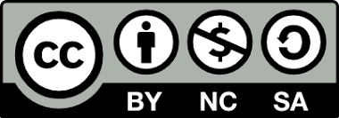

Esta obra y todos sus derivados (Por ejemplo, los libros, la página web, material de difusión, etc) se encuentran bajo los derechos de Bienes Comunes Creativos (del inglés, Creative Commons):

Atribución/Reconocimiento-NoComercial-CompartirIgual 4.0 Internacional

Podes leer más al respecto las condiciones de uso del material de la obra  [aca](https://creativecommons.org/licenses/by-nc-sa/4.0/deed.es). Para usos comerciales, licencias institucionales o versiones extendidas pueden contactarnos por  [mail](mailto:temporalespiral@gmail.com)

En resumen indica:

- **Atribución**: Usted debe dar crédito de manera adecuada , brindar un enlace a la licencia, e indicar si se han realizado cambios . Puede hacerlo en cualquier forma razonable, pero no de forma tal que sugiera que usted o su uso tienen el apoyo de la licenciante.

- **NoComercial**: Usted no puede hacer uso del material con propósitos comerciales.

- **CompartirIgual**: Si remezcla, transforma o crea a partir del material, debe distribuir su contribución bajo la la misma licencia del original.

- **No hay restricciones adicionales**: No puede aplicar términos legales ni medidas tecnológicas que restrinjan legalmente a otras a hacer cualquier uso permitido por la licencia.

### ¿Por qué elegimos estos derechos?

En los tiempos actuales, las posibilidades de que una creación artística o científica quede sesgada y limitada por fines de lucro son considerables y, en nuestra opinión, preocupantes.
El arte, así como el conocimiento, debería ser de libre acceso para todas las personas. Este derecho se ve cada vez más comprometido, y la conciencia de ese comprometimiento se diluye progresivamente en mares de información.
Los derechos de autoría de Bienes Comunes Creativos (Creative Commons) ofrecen una alternativa a esta situación, permitiendo que todas las personas puedan acceder a la obra, a la vez que esta queda protegida del plagio. Por eso nos parece importante destacar el porqué de esta elección de tipo de autoría y cómo esta decisión resguarda esos derechos y hace el material accesible para todas las personas.
