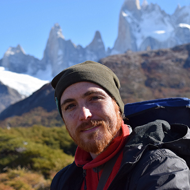
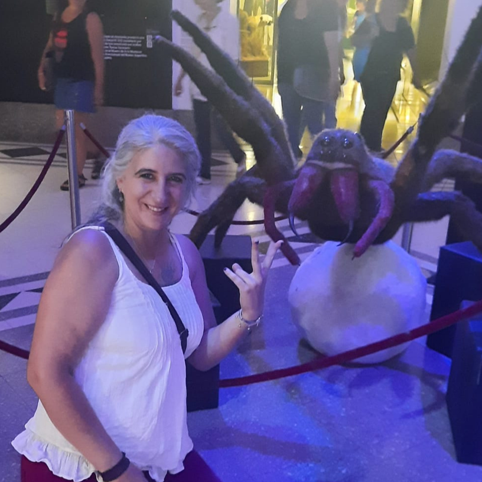

Somos una cooperativa que desarrolla proyectos editoriales. Buscamos que las lecturas sean especiales, profundas y reflexivas, involucrando todos los sentidos posibles. Para ello usamos tecnologías audiovisuales, sin perder de vista la esencia de un buen libro. Cada una de nuestras habilidades enriquecen y hacen únicas las historias que contamos.

Entendemos que, conforme el recorrido de nuestra especie avanza, la cultura, la tecnología y las artes entre otros aspectos, van cambiando. Nuestra cooperativa se suma a los cambios y al mismo tiempo busca reivindicar la literatura más pura, incluso en este mundo digital. Sabemos que la práctica de narrar historias es propia de la humanidad y que, por lo tanto, nos acompañará siempre.

------------------------------------------------------------------

:::: {.columns}

::: {.column width="50%"}

Hola, mi nombre es Sergio Sclovich y soy oriundo de Buenos Aires, Argentina. Resido en Nueva Zelanda desde el año 2017. Soy biólogo evolutivo, instructor de Tai Chi, practicante de meditación Zen y escritor. Soy el autor de esta obra y orgulloso miembro de esta cooperativa que les trae las palabras narradas a una nueva dimensión.

:::

::: {.column width="50%"}

{.img-igual}

::: 

::::

------------------------------------------------------------------

:::: {.columns}

::: {.column width="50%"}

Soy Julieta Antonelli. Vivo en Buenos Aires, Argentina con mi familia de muchas especies. Escribo ficción en la que inevitablemente se filtra la naturaleza. Soy Licenciada en Ciencias Biológicas y Docente de Ciencias Naturales. Trabajo en el Ministerio de Educación de mi ciudad para que el acceso al conocimiento sea un derecho garantizado. Soy parte del equipo de Biodiversidad en la Subsecretaría de Ambiente y Desarrollo Sostenible de la Nación. Conduzco Ciencia Random Podcast.

:::

::: {.column width="50%"}

{.img-igual}

::: 

::::