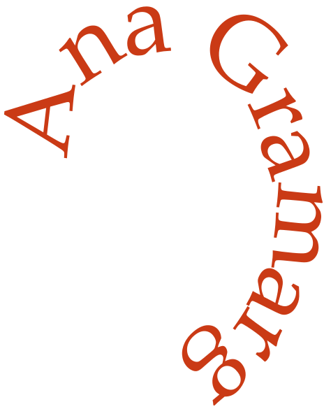
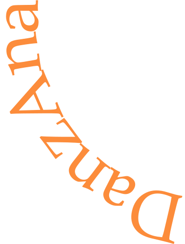
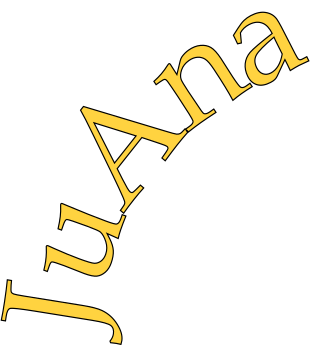
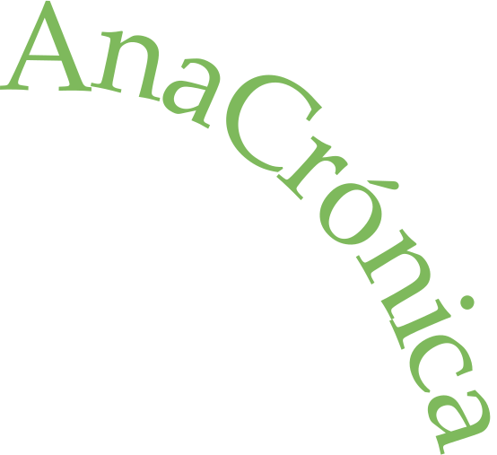
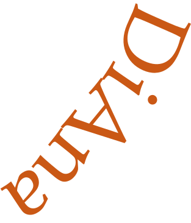

Les damos la bienvenida a la Espiral Temporal, un proyecto colectivo basado en la obra escrita por Sergio Sclovich.

Nuestro ícono es una espiral, que simboliza la interconexión que existe entre las personas entre sí y con el resto de la naturaleza. Reivindicamos la historia del amor a partir de una antología de relatos que se unen en una madeja espiralada, hecha de un hilo conductor.

Buscamos compartir historias, reflexiones y nuevas formas de entender e interpretar las relaciones. Las y los invitamos a ser parte de este viaje artístico leyendo, mirando, escuchando y comentando lo que deseen sobre el proyecto. Podes *clikear* en los títulos de la espiral para conocer más de cada obra.

```{=html}
<div class="image-wrapper">
  
  
  <a href="sinopsis/AnAntologia_Sinopsis.qmd" class="overlay-link overlay-1">
    
  </a>
  
  <a href="sinopsis/AnAntologia_Sinopsis.qmd" class="overlay-link overlay-2">
    
  </a>

  <a href="sinopsis/AnAntologia_Sinopsis.qmd" class="overlay-link overlay-3">
    
  </a>
  
  <a href="sinopsis/AnAntologia_Sinopsis.qmd" class="overlay-link overlay-4">
    
  </a>
  
  <a href="sinopsis/AnAntologia_Sinopsis.qmd" class="overlay-link overlay-5">
    
  </a>
  
  <a href="sinopsis/El_sitial_sinopsis.qmd" class="overlay-link overlay-6">
    
  </a>
  
  <a href="sinopsis/LOBA_sinopsis.qmd" class="overlay-link overlay-7">
    
  </a>
  
   <a href="sinopsis/Sofista_sinopsis.qmd" class="overlay-link overlay-8">
    
  </a>
  
   <a href="sinopsis/AnaLogico_sinopsis.qmd" class="overlay-link overlay-9">
    
  </a>
  
    <a href="sinopsis/Auris_sinopsis.qmd" class="overlay-link overlay-10">
    
  </a>
  
    <a href="sinopsis/ReEvolucion_sinopsis.qmd" class="overlay-link overlay-11">
    
  </a>
  
    <a href="sinopsis/DisUtopia_sinopsis.qmd" class="overlay-link overlay-12">
    
  </a>
  
</div>
```
